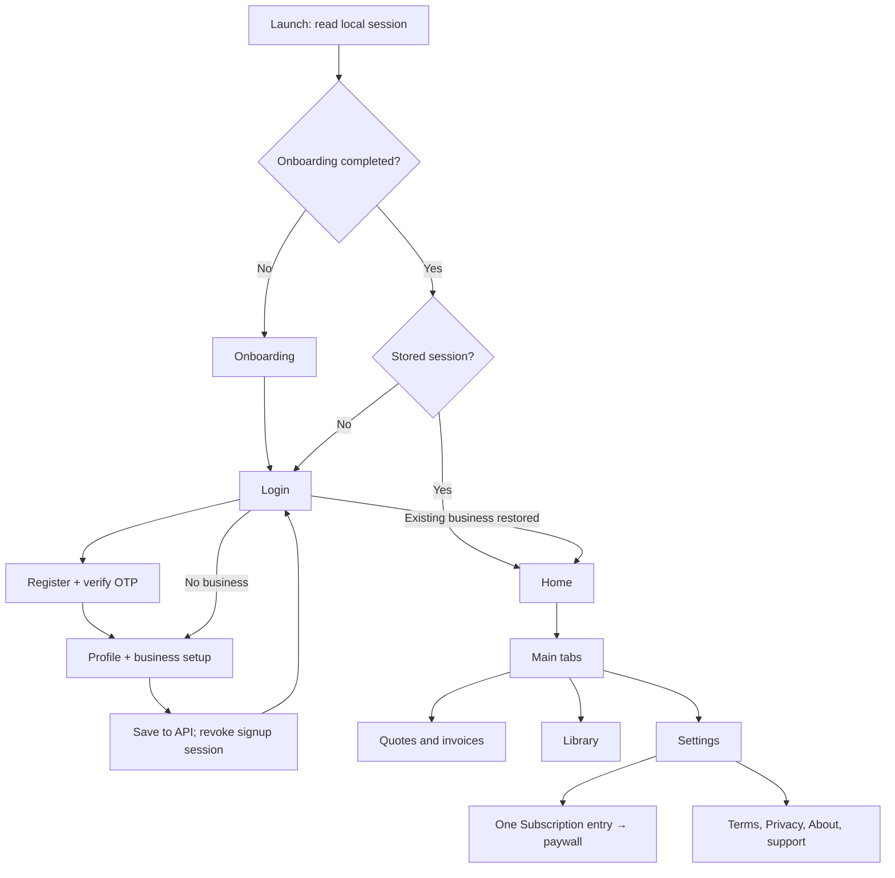
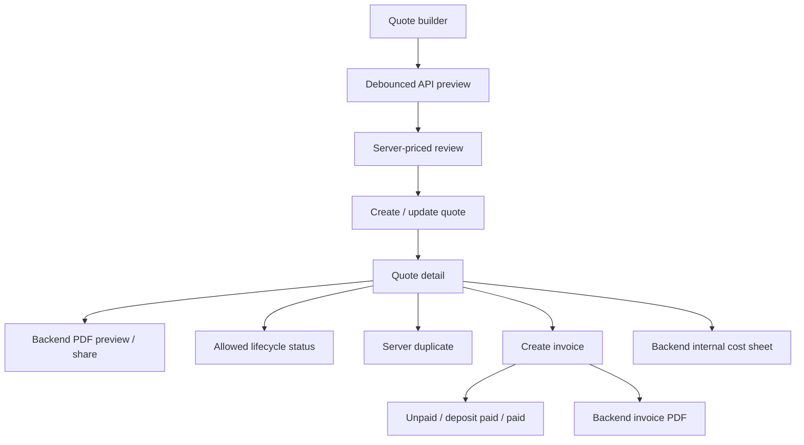

# App flow and screen tree

Screen tree:

- Launch and onboarding
- Auth: Login, Register, OTP, password-reset screen (backend endpoint required)
- Profile/business setup: identity, contact, quote defaults
- Home: API dashboard, recent documents, new-quote action
- Quotes/invoices: history, builder, review, detail, lifecycle/payment actions, edit, duplicate, delete, PDF/cost sheet
- Library: hair product forms; all-item manager for hair/labour/service/material/fee
- Settings: business profile/logo, quote defaults, numbering, pricing/invoice settings, one Subscription/paywall entry, Terms, Privacy, About, support, logout and delete account

Responsive work includes bounded trailing text, wrapping share/legal actions, scrollable forms and editors, error-image fallbacks, and constrained editor widths. Device widths and large-text accessibility still require the Flutter UI checks described in the audit.
